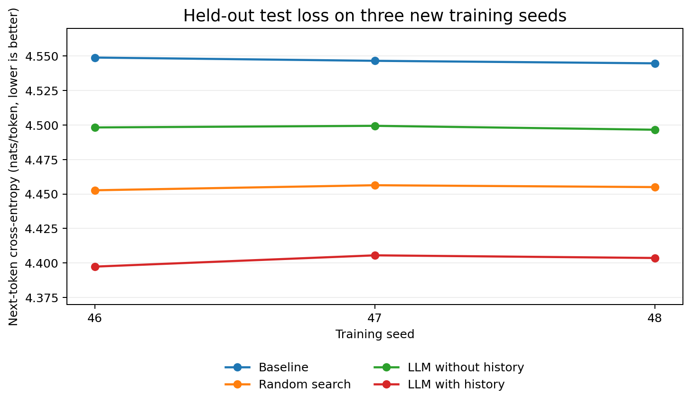

# BabyLM AutoResearch

**Исследовательский проект: помогает ли история экспериментов LLM-агенту эффективнее подбирать гиперпараметры языковой модели?**

В проекте реализован автоматизированный поиск гиперпараметров для небольшой авторегрессионной языковой модели. LLM-агент выбирает следующую конфигурацию обучения, получает измеренный результат и, в одном из режимов, использует историю предыдущих попыток. Цель — проверить, улучшает ли такая обратная связь качество поиска при одинаковом бюджете обучения.

Агент **не изменяет архитектуру нейросети и исходный код обучения**: он выбирает комбинации параметров из фиксированного пространства поиска.

## Основной результат

После поиска лучшие конфигурации были обучены заново в течение **2048 шагов** на трёх новых seed (46, 47, 48) и оценены на внутренней отложенной тестовой выборке.

| Метод | Test Loss ↓ (среднее ± SD) | Perplexity ↓ |
|---|---:|---:|
| Базовая конфигурация | 4,5466 ± 0,0021 | 94,31 |
| Случайный поиск | 4,4547 ± 0,0018 | 86,03 |
| LLM-агент без истории | 4,4980 ± 0,0014 | 89,84 |
| **LLM-агент с историей** | **4,4022 ± 0,0043** | **81,63** |

Агент с историей показал снижение Test Loss на **1,18% относительно случайного поиска** и на **3,18% относительно базовой конфигурации**. На всех трёх новых seed направление преимущества сохранилось.



> **Ограничение:** это результаты на *внутреннем* отложенном наборе, сформированном по группам строк. Он не гарантирует независимости документов и **не является официальным бенчмарком BabyLM**. Три seed недостаточны для широких статистических обобщений.

## Постановка эксперимента

**Модель:** causal Transformer, 2 слоя, 4 головы внимания, размерность эмбеддингов 128, около 1,44 млн параметров. Размер словаря — 8000 токенов.

**Подбираемые гиперпараметры:**

| Параметр | Допустимые значения |
|---|---|
| Learning rate | `0.0005`, `0.001`, `0.002`, `0.003` |
| Weight decay | `0`, `0.01`, `0.1` |
| Dropout | `0`, `0.1`, `0.2` |
| Warmup fraction | `0`, `0.1`, `0.2` |

Всего **108 комбинаций**, включая baseline.

Сравнивались три стратегии:

1. **Random Search:** случайный выбор конфигураций без LLM.
2. **LLM без истории:** агент видит базовый результат, но не получает метрики предыдущих новых попыток.
3. **LLM с историей:** агент видит конфигурации и результаты предыдущих попыток и использует их при выборе следующей.

Для каждой стратегии проведены три серии поиска (seed **43, 44, 45**): общий baseline и по пять новых конфигураций на серию. Каждая короткая тренировка выполнялась **512 шагов** с `batch_size=8` и `block_size=128`. Лучшие рецепты выбирались по итоговому `dev loss` **до просмотра тестовых результатов**.

Для пилота использовалась модель `gpt-6-luna` через сторонний шлюз, совместимый с Responses API. Полная история увеличила расход API-токенов примерно на **28,6%** относительно режима без истории. Расход API-токенов не следует смешивать с количеством токенов, на которых обучалась языковая модель.

## Структура репозитория

```text
babylm-autoresearch/
├── agent_crs.py             # LLM-поиск, режимы с историей и без неё, Random Search
├── train.py                 # Обучение небольшой языковой модели
├── runner.py                # Запуск и учёт экспериментов
├── prepare_data.py          # Подготовка данных и токенизатора
├── validate_long.py        # Проверка лучших конфигураций на 2048 шагах
├── evaluate_test.py        # Оценка на отложенном тесте
├── scripts/
│   └── analyze_results.py  # Повторный расчёт таблиц по сохранённым JSON
├── docs/                    # Исследовательский отчёт и протоколы
├── figures/                 # Графики
├── results/                 # Итоговые JSON и CSV
└── requirements.txt         # Зависимости Python
```

Дополнительные скрипты `agent.py`, `run_agent.py`, `test_agent.py` и документ `README_AGENT.md` сохранены в репозитории как отдельные компоненты ранних экспериментов.

## Быстрая проверка результатов

Для проверки опубликованных таблиц **не нужны API-ключ, датасет или обучение модели**.

```powershell
python -m pip install -r requirements.txt
python scripts/analyze_results.py
```

Скрипт пересчитывает агрегированные показатели по JSON в `results/` и формирует CSV-таблицы.

## Как запустить собственный эксперимент

Команды ниже рассчитаны на **PowerShell в Windows**, из корня репозитория.

**1. Создать окружение и установить зависимости:**

```powershell
python -m venv .venv
.\.venv\Scripts\Activate.ps1
python -m pip install -r requirements.txt
```

**2. Подготовить корпус:**

```powershell
python prepare_data.py --download
```

Данные загружаются из зафиксированной ревизии `BabyLM-community/BabyLM-2026-Strict-Small`; локальные файлы в `data/` не публикуются в Git.

**3. Проверить параметры запуска без обучения:**

```powershell
python agent_crs.py --mode random --name demo_random_s43 --seed 43 --search-seed 143 --trials 5 --max-steps 512 --threads 10 --dry-run
```

**4. Запустить случайный поиск:**

```powershell
python agent_crs.py --mode random --name demo_random_s43 --seed 43 --search-seed 143 --trials 5 --max-steps 512 --threads 10
```

Для режимов `agent` и `no-history` нужен доступ к совместимому API, настроенная переменная окружения `CRS_OAI_KEY` и выбранная модель. **Эти режимы могут расходовать платные API-токены.** Проверяйте адрес шлюза через `--base-url`; не храните ключи в коде и не публикуйте их на GitHub.

```powershell
python agent_crs.py --help
```

Одинаковые seed помогают контролировать случайность обучения, но не гарантируют полностью идентичные результаты между разными версиями библиотек, устройствами и независимыми LLM-вызовами.

## Материалы исследования

- [Полный отчёт на русском](docs/REPORT_RU.md) — гипотеза, методика, результаты, ограничения.
- [Воспроизводимость](docs/REPRODUCIBILITY.md) — протокол, хэши исходников и данных, команды.
- [План следующего эксперимента](docs/NEXT_EXPERIMENT.md) — сравнение полной и сокращённой истории.
- [Результаты короткого поиска](results/crs_repeat_comparison.json).
- [Результаты длинной проверки](results/long_validation.json).
- [Результаты отложенного теста](results/test_results.json).
- [Таблицы CSV](results/tables/).

## Выводы и дальнейшая работа

В данном пилоте доступ к истории экспериментов помог LLM-агенту находить более удачные конфигурации обучения, чем случайный поиск и агент без истории. При этом история увеличивает расход API-токенов, а результаты пока ограничены одной моделью, одним корпусом и небольшим числом повторений.

Следующий этап — сравнить **полную историю**, **сжатую историю** и **отсутствие истории** при одинаковом бюджете, отдельно учитывая качество поиска и стоимость LLM-вызовов.
