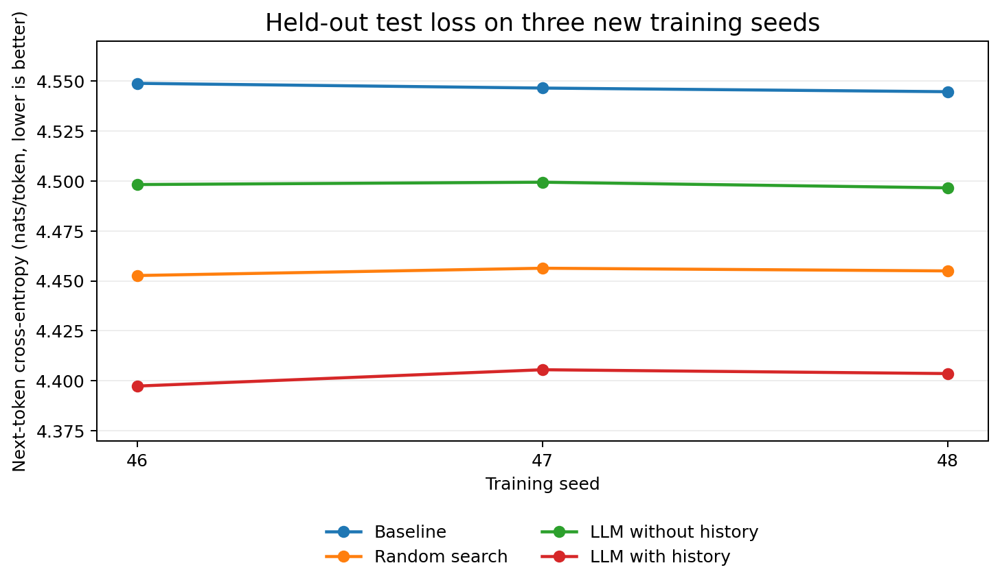

# Влияние истории экспериментов на качество LLM-агента для поиска гиперпараметров малой языковой модели

**Проект:** BabyLM AutoResearch  
**Статус:** завершённый пилот, внутренние эксперименты  
**Дата подготовки отчёта:** 16 ноября 2026 г.

## Аннотация

Исследуется, помогает ли доступ к результатам предыдущих экспериментов LLM-агенту подбирать гиперпараметры небольшой авторегрессионной языковой модели. Сравниваются три стратегии: случайный поиск, LLM без истории предыдущих результатов и LLM с полной историей. Для каждой стратегии проведены три независимые серии короткого поиска с одинаковым бюджетом обучения. Лучшие рецепты перенесены на более длинное обучение с новыми случайными инициализациями, после чего оценены на отложенном тестовом тексте.

**Основной результат:** средняя кросс-энтропия на внутреннем тесте составила **4,4022** у агента с историей против **4,4547** у случайного поиска, **4,4980** у агента без истории и **4,5466** у базовой конфигурации. Разница между агентом с историей и случайным поиском составила **−0,05246 nats/token**, или **−1,18%** относительно случайного поиска. Результат повторился по направлению на всех трёх новых seed. Это свидетельствует в пользу полезности истории в *данной экспериментальной постановке*, но не доказывает её универсального причинного эффекта.

## 1. Постановка задачи и гипотеза

Пусть есть фиксированная архитектура языковой модели и ограниченный бюджет обучения одного кандидата. Требуется выбрать гиперпараметры, минимизирующие конечную кросс-энтропию на внутренней dev-выборке:

$$
\theta^* = \arg\min_{\theta \in \Theta} L_{dev}(\theta; B)
$$

где $\theta$ задаёт скорость обучения, weight decay, dropout и долю warmup, а $B$ обозначает фиксированный бюджет токенов обучения.

**Рабочая гипотеза:** агент, которому доступны результаты предыдущих запусков, выбирает более удачные конфигурации при том же числе испытаний, чем агент, видящий только baseline, и случайный поиск.

Здесь агент **не меняет код модели и архитектуру**: он выбирает одну конфигурацию из заранее заданного дискретного пространства. Это исследование адаптивного выбора рецептов обучения, а не автоматического изобретения новых нейросетевых архитектур.

## 2. Экспериментальная установка

| Параметр | Значение |
|---|---|
| Модель | малая causal Transformer LM, ~1 437 184 параметра |
| Слои / головы / размерность | 2 / 4 / 128 |
| Словарь | 8 000 токенов |
| Устройство | CPU |
| Короткий поиск | 512 шагов, batch size 8, block size 128 |
| Бюджет на одну конфигурацию | 524 288 обучающих токенов |
| Число новых кандидатов | 5 на метод и seed + общий baseline |
| Повторения поиска | seed 43, 44, 45 |
| Перенос рецептов | 2 048 шагов, seed 46, 47, 48 |
| Бюджет на одну длинную тренировку | 2 097 152 обучающих токена |
| Тест | 343 546 оцениваемых токенов, один фиксированный внутренний test split |
| Основная метрика | средняя next-token cross-entropy, nats/token (меньше лучше) |

Пространство поиска содержало 4 значения learning rate (0,0005; 0,001; 0,002; 0,003) и по 3 значения weight decay (0; 0,01; 0,1), dropout (0; 0,1; 0,2) и warmup fraction (0; 0,1; 0,2). Всего 108 сочетаний, включая baseline.

**Стратегии:**

1. **Random:** равномерный случайный выбор кандидатов без повторений, без вызовов LLM.
2. **LLM без истории:** модель видит базовый результат и доступные конфигурации, но не получает значения метрик уже завершённых новых запусков. Испробованные кандидаты исключаются из списка доступных.
3. **LLM с историей:** модель получает baseline и результаты всех ранее завершённых попыток, включая конфигурации и измеренные потери; затем предлагает следующий кандидат и краткую проверяемую гипотезу.

Для LLM использовалась модель `gpt-6-luna` через Responses-совместимый шлюз, `reasoning_effort=low`. Это описание реально использованного экспериментального интерфейса, не рекомендация передавать ключи стороннему сервису. Метрики обучения и вызовы API учитываются раздельно.

## 3. Протокол

1. На каждом из seed 43, 44 и 45 все три стратегии стартовали с одинакового baseline и получили по пять дополнительных попыток. Сравнение внутри одного seed проводилось при одинаковом бюджете на попытку.
2. Для каждой стратегии выбрали **лучший по финальному dev loss рецепт** среди трёх победителей короткого поиска. На тесте рецепты не выбирались.
3. Зафиксированные рецепты обучили с нуля по 2 048 шагов на **новых** seed 46, 47 и 48. Это проверка переноса рецепта на более длинный режим, а не продолжение старых чекпоинтов.
4. Сохранённые `last.pt` были оценены на фиксированном внутреннем тестовом наборе. Тестовый протокол использовал последовательные непересекающиеся блоки, сбрасывал контекст на границах блоков и оценивал каждый токен, кроме первого, один раз. Настройка параметров по этим тестовым оценкам не проводилась.

## 4. Результаты

### 4.1. Короткий поиск (лучший dev loss в каждой серии)

| Метод | Seed 43 | Seed 44 | Seed 45 | Среднее |
|---|---:|---:|---:|---:|
| Random | 4,8144 | 4,7762 | 4,8538 | 4,8148 |
| LLM без истории | 4,9054 | 4,8933 | 4,9138 | 4,9042 |
| **LLM с историей** | **4,7317** | **4,7705** | **4,7811** | **4,7611** |

Агент с историей нашёл лучший рецепт на всех трёх seed короткого поиска. Средние API-расходы за одну серию составили приблизительно **34 561 входной и 746 выходных токенов** для агента с историей, против **26 827 входных и 628 выходных** для агента без истории. Полная история увеличила общий расход API-токенов примерно на **28,6%**; затраты на обучение моделей в сериях были одинаковыми.

### 4.2. Перенос на 2 048 шагов (новые seed)

| Метод | Средний финальный dev loss |
|---|---:|
| Baseline | 4,5323 |
| Random | 4,4368 |
| LLM без истории | 4,4806 |
| **LLM с историей** | **4,3867** |

### 4.3. Отложенный тест (основной результат)

| Метод | Test loss, среднее ± SD (n=3) | Средняя perplexity |
|---|---:|---:|
| Baseline | 4,5466 ± 0,0021 | 94,31 |
| Random | 4,4547 ± 0,0018 | 86,03 |
| LLM без истории | 4,4980 ± 0,0014 | 89,84 |
| **LLM с историей** | **4,4022 ± 0,0043** | **81,63** |

Агент с историей снизил средний test loss на **0,14439 nats/token (3,18%)** относительно baseline и на **0,05246 nats/token (1,18%)** относительно Random. Результат лучше Random на каждом из seed 46, 47, 48. Стандартные отклонения здесь отражают только вариацию по трём запускам и не являются оценкой неопределённости по корпусам или задачам.

### 4.4. Выбранные рецепты для длинного обучения

| Метод | LR | Weight decay | Dropout | Warmup fraction |
|---|---:|---:|---:|---:|
| Baseline | 0,001 | 0,1 | 0,1 | 0,1 |
| Random | 0,003 | 0,1 | 0,1 | 0,1 |
| LLM без истории | 0,001 | 0,01 | 0,0 | 0,1 |
| **LLM с историей** | **0,003** | **0,0** | **0,0** | **0,2** |

В этой постановке высокий LR, отсутствие регуляризации и более длинный warmup оказались полезными для рецепта, найденного агентом с историей. **Это наблюдение, а не универсальная рекомендация** для других размеров моделей, корпусов и бюджетов.

## 5. Интерпретация

Агент с историей использовал обратную связь, чтобы последовательно исследовать параметры: сначала ослаблял регуляризацию, затем увеличивал learning rate и корректировал warmup. Агент без истории не мог так же явно опираться на измеренные потери предыдущих попыток. Поэтому наблюдаемое преимущество согласуется с гипотезой, что память об экспериментах помогает адаптивному поиску.

Однако из этих данных **нельзя строго отделить эффект истории от стохастичности генерации и различий выбранных траекторий**. По три серии на стратегию достаточно для демонстрации пилота, но недостаточно для сильного статистического обобщения. Кроме того, сравниваются стратегии поиска рецептов, а не одинаковые рецепты с включённой/выключенной памятью.

## 6. Ограничения и угрозы валидности

- **Внутренний датасет.** Тест сформирован как удержанная часть с разбиением по группам строк, а не как гарантированно независимый по документам набор. Возможна близость текстов между частями.
- **Неофициальная оценка BabyLM.** Здесь измеряется только next-token cross-entropy. Нет официальных downstream-бенчмарков и нет оснований объявлять рекорд BabyLM.
- **Мало повторений.** Три поисковых seed и три новых seed для переноса. Не оценены доверительные интервалы для широкого класса задач.
- **Различные траектории.** Полная история влияет на выбор следующих кандидатов, а сами LLM-вызовы могут быть недетерминированными. Для причинного утверждения нужна более строгая серия с контролем условий.
- **Изменённый бюджет.** Лучшие рецепты выбраны при 512 шагах, а итоговая проверка выполнена при 2 048 шагах. Перенос продемонстрирован только для этого изменения бюджета.
- **Цена памяти.** Полная история улучшила метрику, но увеличила число входных API-токенов. Время вызовов API и стоимость не следует смешивать со временем обучения.
- **Репликация.** Для полной перепроверки нужны оригинальные `train.py`, скрипты длинной валидации и тестового оценивания, бинарные данные и чекпоинты. В данном пакете лежат результаты и анализ, но не эти исходные компоненты.

## 7. Вывод и следующий эксперимент

В проведённом пилоте **LLM-агент с полной историей оказался лучшей из трёх стратегий поиска** по dev loss и показал лучший результат на внутреннем отложенном тесте после переноса рецепта на новые seed. Выигрыш относительно случайного поиска небольшой в относительных процентах, но стабилен по направлению на всех трёх новых инициализациях. Вывод ограничен конкретной моделью, корпусом, пространством гиперпараметров и бюджетом.

Следующий исследовательский шаг: сравнить **полную историю** с **краткой структурированной сводкой** предыдущих попыток. Главный вопрос: можно ли сохранить качество поиска при меньшем числе входных API-токенов? План эксперимента приведён в `NEXT_EXPERIMENT.md`.

## 8. Проверяемые материалы

- `results/crs_repeat_comparison.json` — девять серий короткого поиска, планы, журналы и победители.
- `results/long_validation.json` — двенадцать длинных тренировок на seed 46–48.
- `results/test_results.json` — двенадцать оценок на отложенном тесте, включая хэши чекпоинтов.
- `scripts/analyze_results.py` — автономная агрегация этих JSON без API-вызовов.
- `results/tables/*.csv` — выгруженные таблицы для проверки.

Все приведённые цифры рассчитаны по этим файлам. Подробности воспроизведения и недостающие компоненты указаны в `REPRODUCIBILITY.md`.
